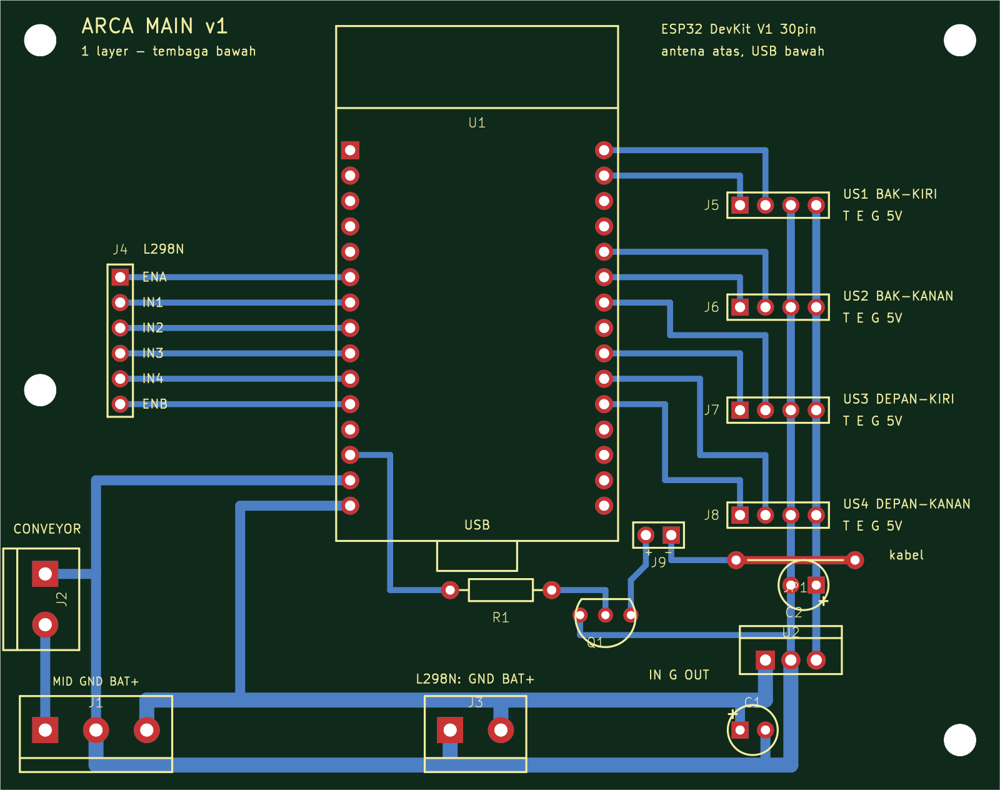

# ARCA PCB v1: 1 layer, modular

> **TL;DR:** Ada 2 desain board: **ARCA MAIN v1** (100 × 79 mm, cetak 1 buah) dan **ARCA SENSOR v1** (26 × 23.5 mm, cetak **4 buah**). Board sensor disambung ke board utama pakai kabel 4 pin, jadi posisi tiap HC-SR04 bisa diatur bebas di lambung kapal. Tembaganya cuma di sisi bawah, semua komponen through-hole, dan ada 1 kabel jumper. File Eagle ada di `eagle/`, Gerber siap cetak di `gerber/`, dan PDF 1:1 buat etching sendiri ada di `print/`.
>
> ⚠️ **Firmware untuk PCB pakai pin yang beda dari versi rakit kabel.** Build dengan env **`arca-pcb`** (lihat bagian Firmware).

## Isi folder

| Folder | Isi | Dipakai untuk |
|---|---|---|
| `eagle/` | `arca-main.brd/.sch`, `arca-sensor.brd/.sch`, `arca.lbr` | Dibuka dan diedit di Eagle 9 / Fusion Electronics. Bisa juga di-import ke KiCad |
| `gerber/*-gerber-1layer.zip` | Tembaga bawah, solder mask bawah, silkscreen atas, outline, drill | **Dikirim ke toko cetak PCB 1 layer** |
| `gerber/*-gerber-2layer.zip` | Sama seperti di atas, ditambah tembaga atas | Kalau toko cuma melayani 2 layer. JP1 otomatis jadi jalur tembaga, jadi nggak perlu kabel jumper |
| `print/*ETCHING*.pdf` | Tembaga bawah skala 1:1 (A4) | Etching sendiri pakai metode setrika / toner transfer |
| `print/*PENEMPATAN*.pdf` | Silkscreen dan outline skala 1:1 | Panduan menaruh komponen, sekaligus buat cek ukuran |
| `preview/` | Gambar board | Lihat cepat |
| `kicad/` | Hasil import ke KiCad + laporan DRC | Bukti verifikasi (0 short, 0 jalur putus) |
| `source/` | Skrip generator (`design.py`) | Kalau mau ubah desain, edit di sini lalu generate ulang |

## Cara pesan ke toko cetak

1. Kirim **`arca-main-gerber-1layer.zip`** (1 pcs) dan **`arca-sensor-gerber-1layer.zip`** (4 pcs). Kalau tokonya minta file Eagle, kirim `eagle/arca-main.brd` dan `eagle/arca-sensor.brd`.
2. Spesifikasi: **FR4 1.6 mm, 1 layer (single side), tembaga 1 oz**, lubang tidak perlu plating. Solder mask dan silkscreen opsional.
3. Jalur paling kecil 0.6 mm dan jarak antar-jalur minimal 0.64 mm (board utama) / 0.84 mm (board sensor). Ini aman untuk toko lokal, bahkan untuk etching sendiri.

## Etching sendiri (toner transfer)

1. Print `print/arca-main-ETCHING-tembaga-bawah-1to1.pdf` pakai **printer laser**, skala **100% / Actual size**, jangan "fit to page".
2. **Cek ukuran dulu:** lebar outline harus **100 mm** (board sensor 26 mm). Kalau meleset, perbaiki setting print.
3. Jangan di-mirror. PDF-nya sudah tampak dari atas, dan setelah ditransfer menghadap ke tembaga, hasilnya otomatis benar.
4. Lanjut setrika, etching, lalu bor. Ukuran bor: 0.8 mm (TO-92), 0.9 mm (R/C), 1.0 mm (header), 1.1 mm (L7805), 1.3 mm (terminal), 3.2 mm (lubang baut).

## Sebelum cetak: cek ukuran ESP32

Footprint ESP32 memakai **jarak baris 25.4 mm (1 inch)** untuk DOIT DevKit V1 30 pin. Ada varian DevKit yang jarak barisnya 22.86 mm. Print `print/arca-main-PENEMPATAN-komponen-1to1.pdf`, taruh ESP32 di atas gambar, lalu pastikan dua baris pinnya pas dengan lingkaran pad. Kalau nggak pas, jangan dicetak dulu (desainnya perlu diubah).

## Daftar komponen per board

**ARCA MAIN v1 (1 pcs)**

| Ref | Komponen | Keterangan |
|---|---|---|
| U1 | 2× female header 1×15 (2.54 mm) | Socket ESP32 DevKit V1. Antena ke atas, USB ke bawah |
| U2 | L7805 TO-220 | Berdiri, bagian logam menghadap ke C2 (atas) |
| C1, C2 | Elco / kapasitor 1 µF | Tanda **+** di silkscreen |
| R1 | Resistor 1 kΩ ¼ W | Tidur, pitch 10.16 mm |
| Q1 | BC337 | Sisi datar mengikuti gambar di silkscreen |
| J1 | Terminal screw 3 pin 5.08 | Baterai: **MID** (titik tengah pack), **GND**, **BAT+** |
| J2 | Terminal screw 2 pin 5.08 | Motor conveyor (GND, MID) |
| J3 | Terminal screw 2 pin 5.08 | Power ke L298N (GND, BAT+), pakai kabel tebal |
| J4 | Male header 1×6 | Ke L298N: ENA IN1 IN2 IN3 IN4 ENB (kabel dupont) |
| J5–J8 | Male header 1×4 atau JST-XH 4 pin | Ke 4 board sensor. Urutan pin: **T E G 5V** |
| J9 | Male header 1×2 | Ke buzzer aktif 5 V (+ / −) |
| JP1 | Seutas kabel | Jumper 5V di sisi komponen (lubang "JP1 kabel") |

**ARCA SENSOR v1 (4 pcs)**

| Ref | Komponen | Keterangan |
|---|---|---|
| J2 | Female header 1×4 | Tempat colok HC-SR04 (VCC TRIG ECHO GND) |
| J1 | Male header 1×4 atau JST-XH 4 pin | Kabel ke board utama (**T E G 5V**) |
| R1 | Resistor 470 Ω ¼ W berdiri | Pembagi tegangan ECHO |
| R2 | Resistor 1 kΩ ¼ W berdiri | Pembagi tegangan ECHO |

Kabel sensor: 4 kabel lurus, pin 1 ke pin 1. Kalau pakai JST-XH, pasang konektornya searah di kedua board.

## Kenapa dibagi begini (modular)

- **Board sensor terpisah:** tiap HC-SR04 bisa ditaruh di mana saja (depan-kiri, depan-kanan, bak) cukup dengan kabel. Kalau satu sensor rusak, tinggal ganti board kecilnya.
- **Divider ECHO ada di board sensor:** yang lewat kabel sudah sinyal 3.3 V, jadi aman untuk ESP32 walau kabelnya panjang.
- **Semua koneksi ke luar lewat terminal atau header:** baterai, L298N, conveyor, dan buzzer bisa dicabut-pasang tanpa solder ulang.

## Firmware (pin PCB beda dengan versi kabel)

Supaya PCB 1 layer bisa dirute tanpa jalur silang, pin ESP32-nya diatur ulang:

| Fungsi | Versi kabel (lomba) | **PCB v1** |
|---|---|---|
| ENA / IN1 / IN2 / IN3 / IN4 / ENB | 25 / 13 / 14 / 16 / 17 / 26 | **32 / 33 / 25 / 26 / 27 / 14** |
| Buzzer | 27 | **13** |
| US1 bak-kiri TRIG / ECHO | 4 / 34 | **22 / 23** |
| US2 bak-kanan TRIG / ECHO | 5 / 35 | **19 / 21** |
| US3 depan-kiri TRIG / ECHO | 18 / 32 | **17 / 18** |
| US4 depan-kanan TRIG / ECHO | 19 / 33 | **4 / 16** |

- PlatformIO: pilih env **`arca-pcb`** (menambah flag `-DARCA_PCB_V1`). Env lama `esp32doit-devkit-v1` tetap untuk versi kabel.
- Logika firmware (kendali, failsafe, sensor) sama persis. Test PC `bash test/run_test.sh` menguji kedua varian: **30/30 lulus** untuk masing-masing.

## Verifikasi yang sudah dilakukan

- DRC mandiri (`source/check.py`): semua net tersambung, jarak tembaga antar-net minimal 0.64 mm (main) / 0.84 mm (sensor), dan tidak ada tembaga yang terlalu dekat tepi atau lubang baut.
- File Eagle di-import ke **KiCad 7**, lalu DRC: **0 short, 0 pelanggaran clearance, 0 pad tidak tersambung**. Sisanya cuma peringatan silkscreen yang saling tumpang (kosmetik).
- Netlist skematik = netlist board, dicek otomatis.
- Gerber dan drill dibaca ulang dengan library terpisah (gerbonara): ukuran outline dan jumlah lubang sesuai (main 75 PTH + 4 lubang baut, sensor 12 PTH + 2).
- **Belum:** dibuka langsung di aplikasi Eagle (tidak tersedia di lingkungan Claude), dicetak, atau dirakit.

## Catatan

- Autodesk menghentikan Eagle pada Juni 2026. File `.brd/.sch` ini tetap bisa dibuka di Eagle 9 yang sudah terpasang, di Fusion Electronics, atau di KiCad (File → Import → Eagle).
- Skematik (`.sch`) dibuat otomatis dengan label net (tiap pin diberi label nama net). Rapi secara koneksi, tapi belum digambar ulang dengan tata letak yang cantik.
- GPIO14 (ENB) mengeluarkan sinyal sebentar saat ESP32 boot, sama seperti versi kabel. Nyalakan kapal sambil dipegang.
