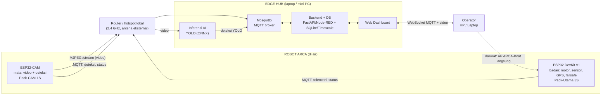
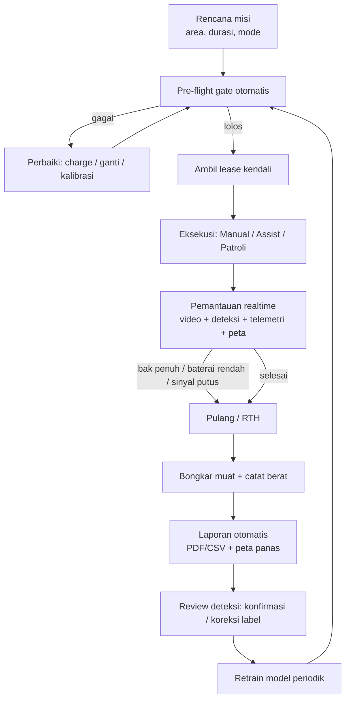

# Analisis Kebutuhan — ARCA v2: Robot Pembersih Perairan + Deteksi Sampah AI + Dashboard IoT

> **TL;DR:** ARCA berevolusi dari "kapal RC lewat WiFi AP" jadi **sistem IoT tiga lapis**: (1) robot dengan 2 MCU (ESP32‑CAM = mata, ESP32 DevKit = badan) dan 2 baterai terpisah, (2) **Edge Hub** di darat (broker MQTT + inferensi AI + database), (3) **Dashboard web** untuk HP/laptop (kendali + video + deteksi realtime + peta sebaran sampah). Tiga keputusan besar: **video ≠ MQTT** (MQTT hanya data & perintah), **warna = pencari kandidat, AI = pemutus**, dan **AP `ARCA-Boat` dipertahankan sebagai jalur darurat**. Nilai bisnis terbesar bukan di robotnya, tapi di **data sebaran & komposisi sampah** yang dihasilkan.

Status: **DRAFT v0.1 untuk direview tim** · Dibuat: 19 Nov 2026 · Branch: `lomba-robotik-november-2026` · Tanggal lomba: _belum diketahui_
Dokumen pendamping: [power-and-wiring-design](power-and-wiring-design.md) · [mqtt-contract](mqtt-contract.md) · [README proyek](README.md)

**Daftar isi:** 1 Ringkasan · 2 Titik awal · 3 Stakeholder · 4 Tujuan & KPI · 5 **Rekomendasi tambahan (kejutan)** · 6 Arsitektur · 7 Proses bisnis · 8 Kebutuhan fungsional · 9 Non‑fungsional · 10 Desain AI · 11 Komunikasi · 12 Hardware ringkas · 13 Dashboard · 14 Risiko · 15 Roadmap & MVP · 16 Keterlacakan · 17 Asumsi & pertanyaan terbuka

---

## 1. Ringkasan eksekutif

**Masalah:** sampah mengambang di perairan sulit dipantau dan dibersihkan; tidak ada data kuantitatif *di mana* dan *sampah apa* yang menumpuk.

**Solusi:** robot ARCA menyusuri perairan dikendalikan dari HP/laptop, melihat dan mengklasifikasi sampah secara realtime, mengumpulkannya lewat conveyor, dan mencatat setiap temuan (jenis, posisi, waktu, foto) ke dashboard.

**Delapan keputusan arsitektur yang direkomendasikan** (alasan lengkap di §5, §6, §11):

| # | Keputusan | Kenapa singkatnya |
|---|---|---|
| D1 | **Tiga bidang komunikasi terpisah:** data/perintah = MQTT, video = HTTP MJPEG (atau WebSocket biner), jalur darurat = AP langsung | MQTT bukan untuk video; satu jalur gagal ≠ semua gagal |
| D2 | **Edge Hub di darat** (laptop/mini PC): Mosquitto + inferensi YOLO + DB + web server | Lomba/sungai sering tanpa internet; ESP32‑CAM terlalu lemah untuk akurasi tinggi |
| D3 | **Deteksi bertingkat:** warna (di ESP32‑CAM) → TinyML (opsional di ESP32‑CAM) → YOLO (di Edge Hub) | Murah dulu, akurat kemudian, tetap jalan walau Hub mati |
| D4 | **Dua baterai terpisah, ground tidak disatukan** (CAM isolasi galvanik) | Noise motor tidak masuk kamera; sesuai permintaan tim |
| D5 | **Pack utama 3S Li‑ion (9–12.6 V) → motor langsung; 5 V dari buck switching** | Tegangan dibagi tanpa membuang arus; L7805 dan titik‑tengah‑pack pensiun |
| D6 | **Driver motor naik kelas** (BTS7960/setara) menggantikan L298N | L298N membuang ±2 V; di 12 V itu daya dan panas terbuang |
| D7 | **Lease kendali:** hanya satu perangkat boleh menyetir pada satu waktu | Mencegah dua operator saling menimpa perintah |
| D8 | **GPS + kompas** untuk geotag deteksi → peta panas sampah | Mengubah robot jadi produk data |

---

## 2. Titik awal (apa yang sudah ada dari ARCA Sep 2026)

| Aspek | ARCA Sep (v1) | Perubahan untuk v2 |
|---|---|---|
| Jaringan | ESP32 jadi AP `ARCA-Boat`, UI di‑serve ESP32 | Tetap sebagai **jalur darurat**; jalur utama lewat Edge Hub (STA + MQTT) |
| Protokol | WebSocket :81 `joystick`/`telemetry` | MQTT (kontrak di [mqtt-contract](mqtt-contract.md)); format JSON dipertahankan semirip mungkin |
| Power | 2S 18650, L7805, conveyor dari titik tengah pack, tanpa BMS/sekring | 3S + BMS + sekring + buck; pack CAM terpisah |
| Motor | L298N, motor kapal ~4.5–5.5 V efektif | Driver rendah‑drop, tegangan penuh |
| Sensor | 4× HC‑SR04 (2 depan, 2 bak) → bak diganti load cell + HX711 (ide 3 Okt) | + GPS, kompas, sensor arus/tegangan, sensor bocor |
| Kamera | ide 3 Okt: ESP32‑CAM STA di AP ESP32, MJPEG, AI di browser HP | Disempurnakan: AI di Edge Hub, deteksi di‑publish ke MQTT |
| Failsafe | 600 ms tanpa joystick → motor mati | Dipertahankan + LWT MQTT + lease |

Konvensi yang **tidak berubah**: motor kanan lebih kencang = belok kiri; ambang halangan 40 cm; keputusan Aman/Terdeteksi/Penuh dihitung firmware, UI hanya menampilkan.

---

## 3. Stakeholder & pengguna

| Peran | Kebutuhan utama | Perangkat |
|---|---|---|
| **Operator** (pengendali) | Menyetir aman, lihat video + deteksi tanpa jeda berarti, tahu baterai/halangan/bak penuh | HP (landscape) atau laptop |
| **Spotter / Analis** | Memeriksa deteksi, konfirmasi/koreksi label, lihat peta & laporan | Laptop |
| **Admin tim / Teknisi** | Flash firmware, lihat log, kalibrasi, kelola model | Laptop |
| **Juri / Penonton** | Memahami dampak: berapa sampah, jenis apa, area mana | Layar besar (mode presentasi read‑only) |
| **Pihak luar (DLH, komunitas, sponsor)** | Laporan terukur | PDF/CSV dari dashboard |

---

## 4. Tujuan, KPI, dan ruang lingkup

**Tujuan:** (G1) kendali jarak jauh yang aman dan responsif; (G2) deteksi + klasifikasi sampah realtime yang cukup andal; (G3) seluruh data terpusat & dapat dianalisis; (G4) operasi aman untuk elektronik, baterai, dan manusia di sekitar air.

**KPI target (usulan — angka final disepakati tim setelah uji lapangan):**

| KPI | Target MVP | Target lanjut | Cara ukur |
|---|---|---|---|
| Latensi kendali (joystick → motor), LAN lokal, p95 | ≤ 300 ms | ≤ 150 ms | cap waktu publish vs aktuasi (LED/log) |
| Latensi video (kamera → layar), LAN lokal | ≤ 1.0 s | ≤ 500 ms | stopwatch di layar difoto |
| Waktu henti saat komunikasi putus | ≤ 700 ms | ≤ 600 ms | cabut WiFi operator, ukur |
| Precision deteksi (kelas "sampah" gabungan) | ≥ 70 % | ≥ 85 % | set uji lapangan berlabel ≥ 200 frame |
| Recall deteksi | ≥ 60 % | ≥ 80 % | idem |
| Durasi operasi pack utama | ≥ 60 menit | ≥ 120 menit | uji beban nyata di air |
| Durasi operasi pack CAM | ≥ 3 jam | ≥ 5 jam | uji streaming kontinu |
| Uptime stream (tanpa reset) per sesi 30 menit | ≥ 95 % | ≥ 99 % | log reconnect |
| Waktu persiapan sebelum turun air (pre‑flight) | ≤ 10 menit | ≤ 5 menit | stopwatch |

**In scope:** robot, 2 MCU, power, dashboard, Edge Hub, AI deteksi, MQTT, dokumentasi.
**Out of scope (fase ini):** navigasi otonom penuh, penghindaran rintangan berbasis kamera tanpa manusia, multi‑robot nyata (tapi namespace MQTT disiapkan), akses publik via internet, perangkat lunak seluler native.

---

## 5. Rekomendasi tambahan — hal yang saya koreksi, tambahkan, atau tantang

### 5.1 Koreksi terhadap rencana awal

1. **"Kirim hasil ESP32‑CAM lewat MQTT" → benar untuk *hasil deteksi*, salah untuk *video*.** MQTT tidak punya mekanisme frame‑drop; video lewat broker menumpuk latensi dan membebani RAM ESP32. Video lewat HTTP MJPEG (`/stream`) langsung ke dashboard; yang lewat MQTT hanya kotak deteksi, event, dan status.
2. **"Pembagian tegangan tanpa menurunkan arus"** — pada konverter *switching* (buck) daya hampir kekal: arus keluaran tidak "turun", justru arus **masukan** yang lebih kecil dari keluaran. Yang membuang arus/daya adalah regulator **linear** (L7805, drop L298N) dan konverter yang rating‑nya kekecilan. Solusi: tiap rail punya konverter sendiri, dipasang **paralel** dari bus baterai (bukan berantai), rating ≥ 1.5× beban. Detail di [power-and-wiring-design](power-and-wiring-design.md#3-cara-membagi-tegangan-tanpa-membuang-arus).
3. **Baterai untuk motor 12 V tidak perlu "dinaikkan" ke 12 V.** Pack 3S (nominal 11.1 V) langsung ke driver motor 12 V adalah desain paling efisien. Boost‑converter ke 12 V akan menarik arus masukan jauh lebih besar dan jadi titik gagal tambahan. (Kalau motor ternyata 6 V, lihat opsi di dokumen power.)
4. **Baterai CAM terpisah + ground terpisah itu *bagus*:** kamera tidak butuh kabel ke ESP32 utama (komunikasi WiFi), jadi isolasi galvanik gratis dan noise motor tidak masuk ke sensor gambar. Jangan sambung GND kedua pack.
5. **Kata "AI via perpaduan warna":** warna sendirian rawan salah di air (pantulan langit, alga hijau, air keruh, busa putih = botol putih). Jadikan warna **generator kandidat** yang murah, bukan klasifikator final (§10).

### 5.2 Ide tambahan yang meningkatkan nilai (urut dampak/biaya)

| # | Ide | Dampak | Biaya | Fase |
|---|---|---|---|---|
| I1 | **Jalur darurat AP:** ESP32 DevKit jalan `WIFI_AP_STA` — tetap memancarkan `ARCA-Boat` + UI lama (`webpage.h`) walau Hub/MQTT mati. Venue tanpa infrastruktur ≠ gagal total | Sangat tinggi (risiko lomba) | Rendah (kode sudah ada) | 0 |
| I2 | **Lease kendali** (satu penyetir aktif, lainnya view‑only; ambil alih dengan konfirmasi) | Tinggi (keselamatan) | Rendah | 0 |
| I3 | **Pre‑flight gate:** dashboard menolak "Mulai misi" bila pack < ambang, sensor mati, kebocoran terdeteksi, RSSI jelek, GPS belum fix. Menggantikan cek manual per sesi | Tinggi | Rendah | 1 |
| I4 | **Data flywheel:** tombol ✔/✖ pada tiap deteksi → simpan foto + label koreksi → retrain model tiap beberapa sesi. Akurasi naik tanpa kerja labeling terpisah | Sangat tinggi (jangka menengah) | Sedang | 2 |
| I5 | **Geotag + peta panas sampah** + komposisi (botol x%, kresek y%) + laporan PDF per misi. Inilah produk data untuk DLH/komunitas/juri | Sangat tinggi (nilai bisnis) | Sedang (butuh GPS) | 3 |
| I6 | **Geofence virtual:** keluar poligon area kerja → motor berhenti + alarm | Tinggi (keselamatan) | Rendah‑sedang | 3 |
| I7 | **Return‑to‑Home** saat sinyal putus atau baterai < 25 % (butuh GPS + kompas) | Tinggi | Sedang | 4 |
| I8 | **Mode Assist:** operator menahan tombol → kapal berbelok ke deteksi terdekat memakai posisi bbox (visual servoing sederhana) | Sedang‑tinggi (demo "wow") | Sedang | 4 |
| I9 | **Sensor bocor + sensor arus/tegangan (INA226)** → SoC akurat (coulomb counting), alarm bocor, deteksi propeller tersangkut dari lonjakan arus | Tinggi | Rendah | 1 |
| I10 | **Mode demo/replay:** dashboard memutar ulang rekaman misi + simulasi telemetri (sudah ada pola Mode Simulasi) — aman dari cuaca/lokasi buruk saat presentasi | Tinggi (lomba) | Rendah | 1 |
| I11 | **HC‑SR04 → versi tahan air** (JSN‑SR04T / A02YYUW) di sisi yang terkena cipratan | Sedang | Rendah | 1 |
| I12 | **ESP‑NOW cadangan CAM → DevKit** untuk ringkasan deteksi bila WiFi infra mati | Sedang | Sedang | ≥4 |
| I13 | **ESP32‑S3‑CAM** (PSRAM 8 MB, instruksi vektor) bila anggaran ada: TinyML 2–3× lebih cepat dari ESP32‑CAM biasa | Sedang | Sedang (beli board) | opsional |

### 5.3 Proses bisnis yang lebih baik (ringkas; detail §7)

Dari "operator menyetir dan menonton" menjadi **siklus misi tertutup**: *Rencana → Pre‑flight → Eksekusi → Pemantauan → Pulang → Bongkar muat → Laporan → Retrain*. Setiap misi menghasilkan satu paket data (rute GPS, deteksi bergeo‑tag, foto, kg terkumpul, durasi, konsumsi energi) yang menjadi dasar laporan dan perbaikan model.

---

## 6. Arsitektur

### 6.1 Konteks sistem

### 6.2 Tiga bidang komunikasi

| Bidang | Isi | Teknologi | Karakter |
|---|---|---|---|
| **Kendali & telemetri** | drive, aksi, status sensor, baterai, GPS | MQTT (QoS 0 untuk aliran cepat, QoS 1 untuk aksi/event) | kecil, sering, butuh failsafe |
| **Video** | frame JPEG | HTTP MJPEG `multipart/x-mixed-replace` dari ESP32‑CAM (cadangan: WebSocket biner) | besar, boleh drop frame |
| **Darurat** | kendali dasar tanpa infrastruktur | WebSocket :81 di AP `ARCA-Boat` (kode v1) | independen dari Hub |

### 6.3 Pembagian tugas dua mikrokontroler

| | **ESP32‑CAM (mata)** | **ESP32 DevKit V1 (badan)** |
|---|---|---|
| Tugas | Capture, stream MJPEG, deteksi warna/TinyML, publish deteksi, `/capture` | Motor, conveyor, HC‑SR04, load cell, GPS, kompas, INA226, buzzer, failsafe, lease, MQTT |
| Boleh mati tanpa merusak kendali? | **Ya** (robot tetap bisa disetir buta) | Tidak |
| Power | Pack‑CAM (1S) → boost 5 V | Pack‑Utama (3S) → buck 5 V |
| Antarmuka ke satunya | **Hanya lewat MQTT** (longgar, tanpa kabel) | idem; berlangganan `cam/detections` untuk Assist/peringatan |

Prinsip: **kegagalan kamera tidak boleh mengganggu kendali** (keputusan 3 Okt dipertahankan). Kabel UART antar‑MCU sengaja tidak dipakai (pin ESP32‑CAM terbatas, dan menambah titik gagal + ground bersama).

---

## 7. Proses bisnis

### 7.1 Siklus misi

### 7.2 Mode operasi

| Mode | Siapa yang menyetir | Fase | Catatan |
|---|---|---|---|
| **Manual** | Operator penuh | 0 | Failsafe + peringatan halangan |
| **Assist** | Operator + bantuan: berhenti otomatis di halangan, tombol "kejar target" | 4 | Mengandalkan bbox + HC‑SR04 |
| **Patroli** | Robot mengikuti waypoint; operator mengawasi & bisa ambil alih | 4+ | Butuh GPS+kompas teruji |
| **Safe** | Otomatis: motor berhenti, buzzer, lampu | 0 | Dipicu komunikasi putus, bocor, e‑stop |

### 7.3 Aturan operasional

- **Satu pemegang lease** per robot; pemegang kedua hanya melihat. Ambil‑alih butuh konfirmasi pemegang lama atau kedaluwarsa (lease habis 3 s tanpa heartbeat).
- **E‑stop dua lapis:** tombol perangkat lunak di dashboard + saklar fisik/kabel putus di robot.
- **Siklus baterai:** dua pack utama bergantian (swap); log siklus & tegangan per sesi di dashboard.
- **Setelah tiap sesi:** keringkan, cek segel kotak, cek dasar lambung dari air masuk, catat anomali.

---

## 8. Kebutuhan fungsional

Prioritas MoSCoW: **M** wajib · **S** sebaiknya · **C** boleh · **W** nanti. Fase merujuk §15.

### 8.1 Kendali & keselamatan

| ID | Kebutuhan | Prio | Fase | Kriteria penerimaan |
|---|---|---|---|---|
| FR‑01 | Operator menyetir via joystick virtual (HP), keyboard WASD, dan gamepad (laptop) | M | 0 | Ketiganya menghasilkan `drive` x,y ∈ [−1,1] ke robot |
| FR‑02 | Mixing differential sama dengan v1 (kanan lebih kencang = belok kiri) | M | 0 | Uji arah di air: konsisten dengan v1 |
| FR‑03 | Failsafe: tanpa perintah `drive` valid 600 ms → motor 0 | M | 0 | Cabut koneksi operator → motor berhenti ≤ 700 ms |
| FR‑04 | MQTT LWT: Hub tahu robot offline; robot tahu Hub offline (>3 s) → mode Safe | M | 0 | Matikan broker → robot masuk Safe + buzzer |
| FR‑05 | Lease kendali (satu penyetir aktif) | M | 0 | Dua klien kirim `drive`: hanya pemegang lease yang dieksekusi |
| FR‑06 | E‑stop perangkat lunak dan fisik | M | 0 | Tekan → driver di‑disable < 100 ms |
| FR‑07 | Jalur darurat AP `ARCA-Boat` + UI v1 tetap berfungsi | M | 0 | Broker mati, HP ke `192.168.4.1` → tetap bisa menyetir |
| FR‑08 | Peringatan halangan depan kiri/kanan (≤ 40 cm) dan bak penuh | M | 0 | Sama dengan v1 |
| FR‑09 | Geofence virtual | S | 3 | Keluar poligon → Safe + notifikasi |
| FR‑10 | Return‑to‑Home otomatis (sinyal putus / baterai < 25 %) | S | 4 | Uji di area aman: kembali ≤ 5 m dari titik awal |
| FR‑11 | Pre‑flight gate | S | 1 | Tombol Mulai terkunci jika ≥ 1 syarat gagal |

### 8.2 Penginderaan & telemetri

| ID | Kebutuhan | Prio | Fase | Kriteria penerimaan |
|---|---|---|---|---|
| FR‑20 | Telemetri 5 Hz: motor, halangan, bak, jarak sensor | M | 0 | Frekuensi terukur ≥ 4 Hz di dashboard |
| FR‑21 | Tegangan & arus tiap pack, SoC (tegangan + coulomb) | M | 1 | Selisih tegangan < 0.1 V dari multimeter |
| FR‑22 | Berat bak (load cell + HX711), peringatan beban maksimum | S | 2 | Kalibrasi anak timbangan; error ≤ 5 % |
| FR‑23 | GPS (lat/lon/sat/HDOP) + kompas | S | 3 | Fix di luar ruangan; heading ± 10° |
| FR‑24 | Sensor bocor lambung → alarm + Safe | S | 1 | Basahi sensor → alarm ≤ 1 s |
| FR‑25 | Pembacaan RSSI kedua MCU | S | 1 | Tampil di dashboard |

### 8.3 Penglihatan & AI

| ID | Kebutuhan | Prio | Fase | Kriteria penerimaan |
|---|---|---|---|---|
| FR‑30 | Streaming video MJPEG ke dashboard (QVGA, ≥ 10 fps) | M | 1 | Latensi ≤ 1 s, tanpa reset 30 menit |
| FR‑31 | Deteksi warna di ESP32‑CAM: bbox kandidat + skor | M | 1 | ≥ 8 fps pada QQVGA/QVGA; bbox muncul di overlay |
| FR‑32 | Publish deteksi ke MQTT (`cam/detections`) | M | 1 | Skema sesuai [mqtt-contract](mqtt-contract.md) |
| FR‑33 | Inferensi YOLO di Edge Hub dari stream; publish hasil | S | 2 | ≥ 5 fps, precision/recall sesuai KPI |
| FR‑34 | Klasifikasi: botol, kresek, gelas/kemasan, styrofoam, kaleng, vegetasi (bukan target), lainnya | S | 2 | Taksonomi §10.3 |
| FR‑35 | Overlay bbox + label + skor pada video di dashboard | M | 1 | Overlay selaras video (± 1 frame) |
| FR‑36 | Event deteksi tersimpan (foto, kelas, skor, waktu, posisi) | S | 2 | Terlihat di galeri setelah sesi |
| FR‑37 | Konfirmasi/koreksi label oleh pengguna | S | 2 | Label tersimpan, bisa diekspor untuk training |
| FR‑38 | Kontrol kamera dari dashboard (resolusi, fps, mode deteksi, kualitas JPEG) | C | 1 | Perubahan berlaku tanpa reflash |
| FR‑39 | Mode Assist berbasis bbox | C | 4 | Robot menghadap target terdekat ± 15° |

### 8.4 Dashboard & data

| ID | Kebutuhan | Prio | Fase | Kriteria penerimaan |
|---|---|---|---|---|
| FR‑50 | Dashboard responsif HP (landscape) + laptop | M | 0–1 | Semua kontrol dapat dipakai di 375×812 dan 1366×768 |
| FR‑51 | Panel: video+overlay, telemetri, baterai ×2, status koneksi, peringatan | M | 1 | Semua tampil bersamaan |
| FR‑52 | Peta jejak (GPS bila ada, dead‑reckoning bila tidak) + penanda deteksi | S | 3 | Marker per deteksi dengan foto |
| FR‑53 | Peta panas sampah + komposisi per sesi | S | 3 | Agregasi sesuai data |
| FR‑54 | Laporan sesi PDF/CSV | S | 3 | Berisi durasi, jarak, kg, jumlah per kelas |
| FR‑55 | Autentikasi & peran (operator, viewer, admin) | M | 1 | Viewer tidak bisa mengirim `drive` |
| FR‑56 | Mode presentasi read‑only layar besar | C | 3 | Tanpa kontrol, tampil KPI & peta |
| FR‑57 | Mode demo/replay | S | 1 | Memutar sesi terekam tanpa robot |
| FR‑58 | Peta offline (tile ter‑cache / grid polos) | S | 3 | Berfungsi tanpa internet |
| FR‑59 | Log & diagnostik (versi firmware, uptime, reset reason, RSSI) | S | 1 | Terlihat di halaman admin |

---

## 9. Kebutuhan non‑fungsional

| ID | Kategori | Kebutuhan |
|---|---|---|
| NFR‑01 | Kinerja | Latensi dan fps sesuai KPI §4; airtime WiFi dibagi: video ≤ 1.5 Mbps agar paket kendali tidak terlambat |
| NFR‑02 | Keandalan | Auto‑reconnect WiFi/MQTT dengan backoff; watchdog ESP32 aktif; reset tidak menyebabkan motor bergerak sendiri (EN driver di‑pull‑down) |
| NFR‑03 | Keselamatan listrik | BMS 3S, sekring tiap cabang, konektor ber‑polaritas, isolasi sambungan, pack dalam kotak kering (lihat dokumen power) |
| NFR‑04 | Keselamatan fungsional | Fail‑stop: semua kondisi tak terdefinisi → motor berhenti |
| NFR‑05 | Ketahanan air | Elektronik di kotak IP65+, kabel melewati cable gland, sensor luar tahan air/cipratan, coating PCB |
| NFR‑06 | Keamanan siber | WiFi WPA2 password kuat; broker wajib autentikasi + ACL per klien; hanya `operator` boleh publish `cmd/*`; firmware tanpa kredensial hard‑coded di repo (pakai `secrets.h` di‑gitignore) |
| NFR‑07 | Operabilitas offline | Seluruh fungsi inti jalan tanpa internet |
| NFR‑08 | Dayaguna | Firmware: dua core dimanfaatkan (core 0 jaringan, core 1 kontrol/sensor); loop kontrol tidak boleh diblokir `pulseIn` panjang |
| NFR‑09 | Perawatan | Firmware dapat di‑update OTA (ArduinoOTA/HTTP OTA) — tidak perlu membongkar kotak |
| NFR‑10 | Kompatibilitas | Chrome Android, Safari iOS, Chrome/Edge desktop |
| NFR‑11 | Dokumentasi | Setiap keputusan di decision‑log; kontrak MQTT versi‑an (`v1`) |
| NFR‑12 | Reproduksibilitas | Firmware memakai PlatformIO dengan versi library terkunci |

---

## 10. Desain AI/persepsi

### 10.1 Realitas perangkat keras

ESP32‑CAM (ESP32 240 MHz, tanpa NPU, PSRAM 4 MB) cukup untuk **stream + pengolahan piksel ringan** dan **TinyML kecil** (mis. FOMO/MobileNet 96×96, kisaran 1–5 fps — *estimasi, wajib diukur*), tidak untuk YOLO penuh. Karena itu pipeline dibagi bertingkat.

### 10.2 Pipeline bertingkat

| Tier | Lokasi | Metode | Output | Fungsi |
|---|---|---|---|---|
| **T0 Warna** | ESP32‑CAM | Model statistik air (histogram/median HSV bagian bawah‑tengah frame) → piksel menyimpang = kandidat; buang pantulan (S rendah & V tinggi); morfologi + connected components | bbox kandidat + skor | Murah (≥ 8 fps), selalu aktif, tak butuh data latih, **bootstrap dataset** |
| **T1 TinyML** | ESP32‑CAM (opsional) | FOMO / MobileNet kecil, di‑latih dari foto sungai sendiri | kelas + titik/bbox kasar | Deteksi cukup baik walau Hub mati |
| **T2 YOLO** | Edge Hub | YOLOv8n/11n (ONNX Runtime, CPU atau GPU) pada frame dari stream | kelas + bbox + skor akurat | Sumber utama dashboard |

**Fusi:** dashboard menampilkan hasil T2 (bila ada) → jatuh ke T1 → jatuh ke T0. Penurunan tingkat ditampilkan jelas ("AI: YOLO / TinyML / Warna").

### 10.3 Taksonomi kelas awal

`botol_plastik` · `kantong_plastik` · `gelas_kemasan` · `styrofoam` · `kaleng` · `vegetasi` (eceng gondok, daun, ranting — **bukan target**, mencegah salah ambil) · `lainnya`. Warna kategori di dashboard konsisten dengan peta panas.

### 10.4 Menangani masalah khas air

| Masalah | Mitigasi |
|---|---|
| Silau/pantulan | Filter polarisasi di depan lensa; abaikan piksel S rendah‑V tinggi di T0; kamera agak menunduk; hindari menghadap matahari |
| Air keruh/hijau berubah | Model air adaptif per frame (bukan ambang tetap) |
| Gelombang kecil menyerupai blob | Persistensi temporal: kandidat harus muncul ≥ N frame berurutan |
| Kamera bergoyang | Exposure otomatis cepat; resolusi QVGA; stabilisasi dengan filter IIR pada bbox |
| Kotak berembun | Silica gel, jendela anti‑fog, ventilasi |
| Dataset kurang | T0 menangkap kandidat otomatis → manusia mengonfirmasi (I4) → 200–500 gambar cepat terkumpul |

### 10.5 Pelatihan & siklus hidup model

1. Kumpulkan foto sungai/kolam nyata (variasi cahaya & cuaca), label di Roboflow/CVAT/Label Studio.
2. Latih YOLO (Edge Hub/Colab); ekspor ONNX; simpan di `models/vN/` dengan catatan metrik.
3. Evaluasi pada **set uji lapangan terpisah** (tidak dipakai latih); catat precision/recall per kelas.
4. Deploy: Hub memuat model baru tanpa mengganggu robot.
5. Ulangi dengan data koreksi dari dashboard.

---

## 11. Komunikasi

### 11.1 Perbandingan opsi

| Opsi | Kelebihan | Kekurangan | Putusan |
|---|---|---|---|
| **MQTT** (Mosquitto) | Pub/sub, LWT, retained, banyak klien, ekosistem dashboard | Bukan untuk video; butuh broker | ✅ data & perintah |
| HTTP MJPEG | Sederhana, jalan di ``, tidak perlu broker | Satu arah, tanpa kontrol aliran | ✅ video |
| WebSocket biner | Frame‑drop terkontrol | Kode klien lebih banyak | Cadangan video |
| WebSocket langsung (v1) | Latensi rendah, tanpa broker | Satu‑ke‑satu, tidak skalabel | ✅ jalur darurat |
| ESP‑NOW | Tanpa router, latensi rendah | Jangkauan & channel harus sama | Opsi fase lanjut (I12) |
| LoRa | Jangkauan km | Throughput kecil, tak cocok video | ❌ saat ini |
| 4G di robot | Jarak jauh tanpa router lokal | Biaya, latensi, video berat | Fase lanjut (via router 4G, bukan ESP32) |

### 11.2 Topologi jaringan yang direkomendasikan

- **Fase 0–2:** travel router/hotspot di tepi air (2.4 GHz, kanal 1/6/11 tersepi, kanal dikunci) — Hub, HP, ESP32‑CAM, ESP32 DevKit semua klien. **Antena eksternal** di kedua ESP32 (U.FL pada CAM; antena panel/omni di router).
- **Fase 4+:** router 4G/5G di robot atau di Hub dengan VPN (Tailscale/WireGuard) untuk akses jarak jauh; video tetap diproses lokal, hanya snapshot event dan telemetri yang naik ke cloud.
- Catatan kanal: saat `WIFI_AP_STA`, kanal AP mengikuti kanal STA — jangan andalkan keduanya di kanal berbeda.

### 11.3 Keamanan broker

Mosquitto: `allow_anonymous false`, user terpisah (`robot-ctrl`, `robot-cam`, `hub`, `web-operator`, `web-viewer`), ACL per topik, listener WebSocket (9001) untuk dashboard. TLS wajib bila keluar dari LAN. Detail & skema di [mqtt-contract](mqtt-contract.md).

---

## 12. Hardware ringkas (detail di [power-and-wiring-design](power-and-wiring-design.md))

| Subsistem | Rekomendasi |
|---|---|
| Pack‑Utama | **3S3P** 18650 high‑drain (≥ 15 A kontinu per sel, asli), BMS 3S ≥ 20 A, ≈ 9 Ah / ≈ 100 Wh |
| Pack‑CAM | **1S2P** 18650 + proteksi + charger USB‑C + **boost 5 V ≥ 2 A** |
| Regulasi | Motor/conveyor: langsung dari bus 3S. Logika 5 V: **buck sinkron ≥ 3 A**. Kamera: boost 5 V ≥ 2 A + elco 1000 µF |
| Motor driver | **BTS7960** ×2 (atau setara ≥ 10 A) menggantikan L298N |
| Proteksi | Sekring utama + per cabang, TVS di bus 12 V, XT60, saklar rating ≥ 20 A DC |
| Sensor tambahan | GPS (NEO‑M8N/M10), kompas (QMC5883L/HMC), INA226, sensor bocor, load cell + HX711, HC‑SR04 → versi tahan air |
| Antena | U.FL eksternal untuk ESP32‑CAM; posisi di atas lambung |

**Anggaran pin DevKit (perlu audit GPIO — di luar dokumen ini):** US ×4 = 8 · driver BTS7960 ×2 = 4 PWM (+EN bersama 1) · HX711 = 2 · buzzer = 1 · ADC tegangan = 1 · GPS UART = 2 · I2C (kompas, INA226) = 2 · sensor bocor = 1 → **≈ 22 dari ~25 pin aman**. Sisa tipis; kalau perlu tambah, ganti US dengan versi UART atau pakai I/O expander (PCF8574).

---

## 13. Desain dashboard

**Tata letak (laptop):** kiri‑atas video + overlay bbox · kanan‑atas peta/jejak · kiri‑bawah joystick + status lease + tombol E‑stop/Buzzer/Mode · kanan‑bawah telemetri (motor, halangan, bak/berat, baterai ×2, RSSI, GPS) · bawah galeri deteksi (✔/✖) dan log peringatan.
**HP landscape:** video penuh, kontrol sebagai overlay semitransparan; panel lain lewat tab geser.

**Teknologi (usulan):**
- **MVP lomba:** Mosquitto + **Node‑RED** (Dashboard 2) *atau* halaman HTML tunggal + `mqtt.js` melalui WebSocket MQTT — pilih yang tim kuasai. Cepat, minim backend.
- **Lanjut:** backend FastAPI/Node + SQLite→TimescaleDB, Grafana untuk analitik, Leaflet untuk peta.
- Satu sumber UI: lanjutkan pola v1 (`web-ui/arca-control.html` → build).

**Perilaku kunci:** tombol kendali nonaktif tanpa lease; banner merah saat robot offline/Safe; deteksi tampil dengan umur (memudar setelah 2 s); semua alarm bersuara + visual.

---

## 14. Risiko

| ID | Risiko | Dampak | Kemungkinan | Mitigasi |
|---|---|---|---|---|
| R1 | Brownout ESP32‑CAM (puncak ±400–500 mA) | Reset saat stream | Tinggi | Boost 5 V ≥ 2 A, elco 1000 µF dekat pin, kabel pendek tebal |
| R2 | Airtime WiFi jenuh → perintah terlambat | Failsafe trip / kontrol patah | Sedang | Batasi fps/resolusi, QoS 0 untuk `drive`, kanal dikunci, uji khusus |
| R3 | Jangkauan WiFi di air pendek | Putus saat jauh | Tinggi | Antena eksternal; geofence berdasarkan RSSI; RTH |
| R4 | Kebocoran / elektronik basah | Kerusakan, bahaya baterai | Sedang | Kotak IP65+, gland, coating, sensor bocor, baterai di kompartemen kering |
| R5 | Baterai Li‑ion palsu/tak seimbang | Api, daya jeblok | Sedang | Sel asli, BMS 3S, charger balance, sekring, cek tegangan per sel |
| R6 | Akurasi AI rendah di lapangan | Demo gagal | Tinggi | Mulai dari warna+filter, kumpulkan data nyata sedini mungkin, uji di lokasi serupa |
| R7 | Tak ada internet/infrastruktur di venue | Dashboard tak jalan | Sedang | Edge Hub lokal + jalur darurat AP |
| R8 | Motor driver panas / lonjakan stall | Gagal tengah misi | Sedang | BTS7960 + heatsink, sekring, deteksi arus lonjakan (INA226) |
| R9 | Beban pin ESP32 hampir penuh | Tak bisa tambah fitur | Sedang | Audit GPIO awal, I/O expander |
| R10 | Waktu terbatas (tanggal lomba belum jelas) | Scope tak selesai | Tinggi | MVP cut §15, fase bertahap, fitur "C/W" dikorbankan lebih dulu |
| R11 | Sampah tersangkut baling/conveyor | Motor terbakar | Sedang | Deteksi lonjakan arus → hentikan & mundur singkat |
| R12 | Privasi/etika kamera di area publik | Komplain | Rendah | Simpan foto hanya saat event, retensi terbatas |

---

## 15. Roadmap & MVP

> Tanggal lomba November belum diketahui. Estimasi di bawah dalam **satuan kerja relatif**; sesuaikan begitu tanggal pasti.

| Fase | Isi | Hasil | Estimasi |
|---|---|---|---|
| **0 Fondasi** | Pack + proteksi + driver baru; MQTT di firmware DevKit (telemetri+drive+LWT+lease); `AP_STA`; dashboard minimal (kendali + status) | Robot disetir via MQTT, darurat via AP | 1–1.5 pekan |
| **1 Mata** | Firmware CAM (MJPEG + T0 warna + publish deteksi), overlay di dashboard, INA226 + bocor, pre‑flight, mode demo | Video + deteksi warna realtime | 1–1.5 pekan |
| **2 Otak** | Kumpulkan data, latih YOLO, Hub inferensi, galeri + ✔/✖, load cell | Klasifikasi akurat + dataset tumbuh | 1.5–2 pekan |
| **3 Data** | GPS+kompas, peta, peta panas, laporan PDF, geofence | Produk data | 1–2 pekan |
| **4 Otonomi** | Assist, RTH, patroli | Demo lanjutan | 2+ pekan |

**MVP cut untuk lomba (rekomendasi):** Fase 0 + Fase 1 + sebagian Fase 2 (YOLO jika data cukup). Fase 3–4 hanya jika waktu sisa; geofence/RTH didahulukan dibanding patroli karena menyangkut keselamatan.

**Definition of Done tiap fase:** kriteria penerimaan FR terkait lulus; uji di air; keputusan tercatat di decision‑log; catatan lapangan masuk `0_Capture`.

---

## 16. Keterlacakan terhadap permintaan awal

| Permintaan pengguna | Dipenuhi oleh |
|---|---|
| U1 — Remote HP/laptop, lihat ESP32‑CAM + AI realtime | FR‑01, FR‑30…35, FR‑50/51, §13 |
| U2 — Dua MCU (CAM = visual→MQTT/lainnya; DevKit = sensor+motor→MQTT), baterai, IoT | §6.3, §11, FR‑20…25, mqtt‑contract |
| U3 — Portal dashboard sebagai informasi & kendali | §13, FR‑50…59 |
| U4 — Dua baterai (CAM kecil, DevKit besar), 5 V & 12 V, bagi tegangan tanpa kehilangan arus, wiring & komponen aman | D4, D5, D6, [power-and-wiring-design](power-and-wiring-design.md), NFR‑03 |
| Tambahan: ide bisnis proses lebih baik | §5, §7, I1–I13 |

---

## 17. Asumsi & pertanyaan terbuka

**Asumsi (belum terverifikasi — ukur/konfirmasi):**
- A1 Motor baling & conveyor **12 V** (rating belum dikonfirmasi — pertanyaan lama di inbox).
- A2 Arus kerja ≈ 2–3 A per motor baling, stall 6–8 A, conveyor 0.5–1 A (**harus diukur**).
- A3 Edge Hub = laptop tim (CPU saja cukup untuk YOLOv8n ±5–10 fps pada 320×320; GPU menaikkan).
- A4 Lokasi lomba punya area 2.4 GHz yang cukup bersih; tidak dijamin internet.
- A5 ESP32‑CAM yang dipakai = AI‑Thinker (OV2640, PSRAM 4 MB).

**Pertanyaan untuk tim (jawaban mengubah desain):**
1. **Tanggal lomba November** dan format penilaian (juri menilai teknis, dampak, atau demo)?
2. **Rating tegangan & arus motor baling/conveyor** (plat nama / ukur stall)?
3. Apakah anggaran memungkinkan **ESP32‑S3‑CAM** (I13), GPS, driver BTS7960, dan antena eksternal?
4. Edge Hub: laptop siapa, spesifikasi, OS? Ada GPU?
5. Area uji: kolam, danau, atau sungai arus? (menentukan daya dorong & jangkauan)
6. Sensor bak: tetap load cell (ide 3 Okt) atau tambah ultrasonik volume?
7. Perlu dashboard bisa diakses dari internet (juri jarak jauh) atau cukup lokal?
8. Bahasa antarmuka: Indonesia saja atau dwibahasa?
